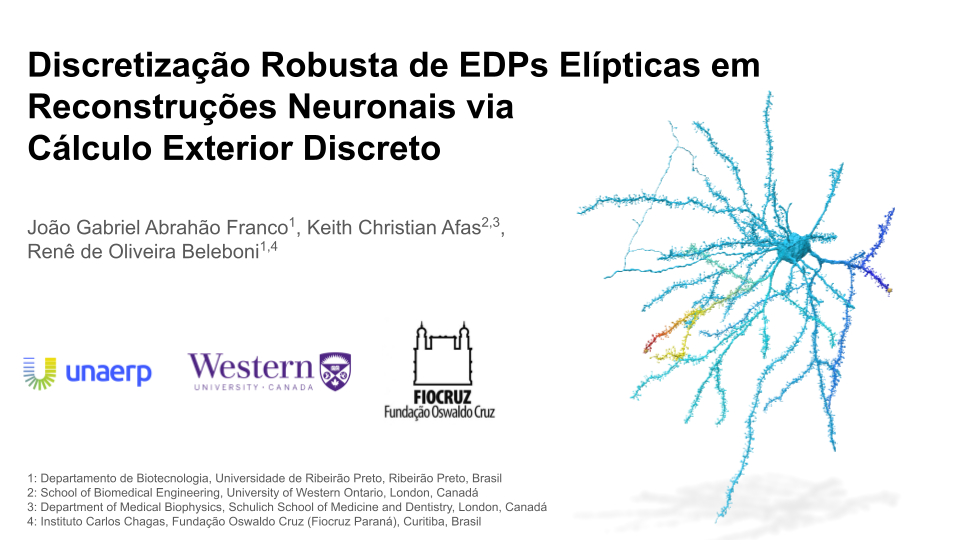
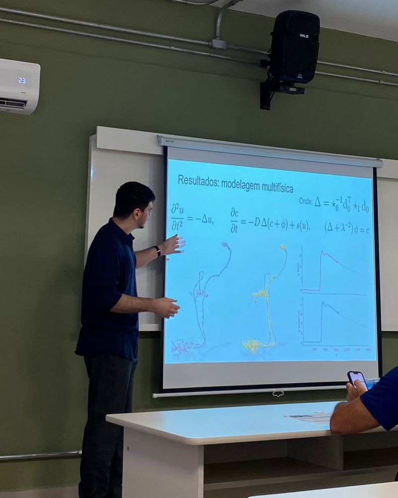
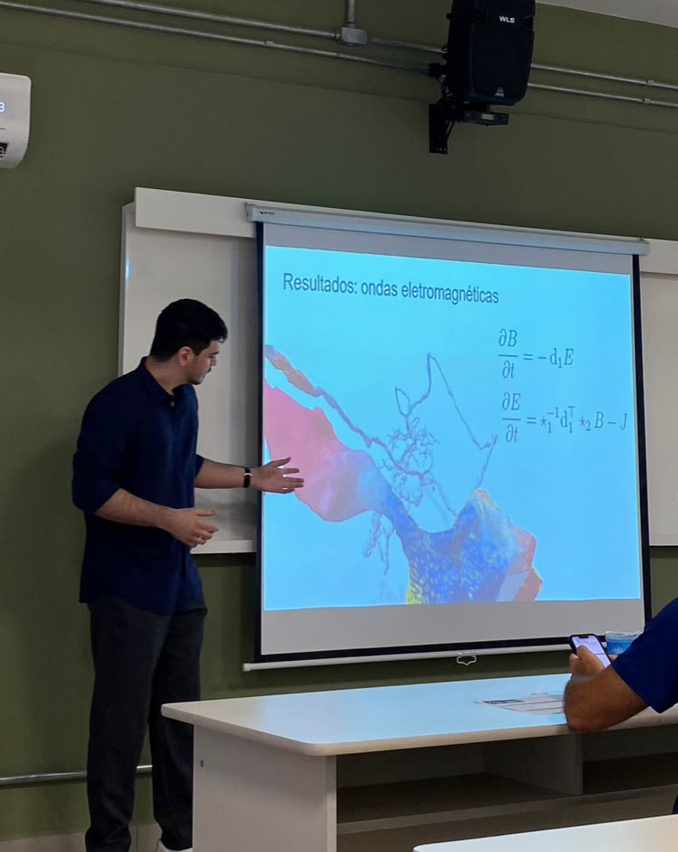

Oral presentation at the 27th Congress of Scientific Initiation and Research (CONIC), Universidade de Ribeirão Preto (UNAERP).

Original title: *"Discretização Robusta de EDPs Elípticas em Reconstruções Neuronais via Cálculo Exterior Discreto"*.

Joint work with Keith Christian Afas and Renê de Oliveira Beleboni.

  
  
  

